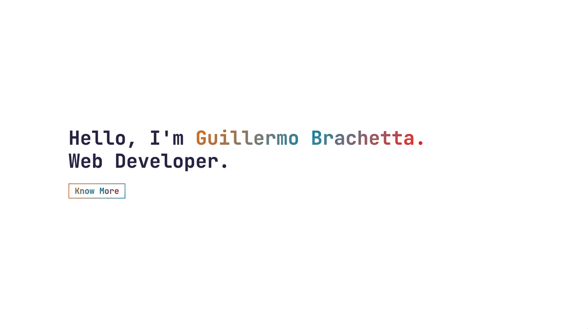

<!-- markdownlint-disable MD013 MD033 -->
# Guillermo Brachetta — Developer & Baroque Performer

<p align="center">
  <a href="https://www.gbrachetta.com/">
    
  </a>
</p>

<p align="center">
  <a href="https://app.netlify.com/projects/gbrachetta/deploys">
    
  </a>
</p>

<p align="center">
  <strong>Web Developer & Baroque Performer</strong><br />
  <em>Usually at a keyboard.</em>
</p>

<p align="center">
  <a href="https://www.gbrachetta.com/"><strong>Explore Live Portfolio »</strong></a>
</p>

---

## Overview

Personal portfolio and curated case archive for Guillermo Brachetta, bridging
modern full-stack web engineering with early music performance.

Crafted with a tactile, comic-novel visual identity: warm paper tones
(`#f1f0e9`), rich ink (`#26332c`), halftone dot textures, dynamic card tilts,
coprime color cycling, and hand-inked brush accents.

## Tech Stack

- **Framework:** Gatsby 5 & React 18 (pre-rendered semantic HTML for speed and SEO)
- **Styling:** Custom Sass / SCSS (Graphic Novel theme, Bangers & Comic Neue typography)
- **Dossier & CV:** Interactive web CV (`/cv`) paired with a synced, XeLaTeX-compiled printable dossier
- **Deployment:** [Netlify](https://www.netlify.com/) (continuous deployment from `master`)

## Getting Started

Requires **Node 22** (`22.23.4`, pinned in `.nvmrc`).

```bash
# Load pinned Node version
nvm use

# Install dependencies
npm install

# Start local dev server (http://localhost:8000)
npm start
```

For guidelines on adding new projects, compiling the CV PDF, or visual rhythm rules, see [MAINTENANCE.md](MAINTENANCE.md).
